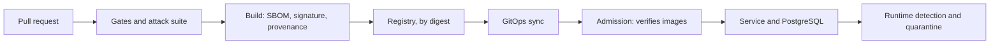

<!-- Author: Nicola Antonello -->

# attack-proven-supply-chain

`attack-proven-supply-chain` is a software supply chain security platform that attacks
itself. Every change is scanned, built, signed and policy-checked on its way to
Kubernetes, and an automated attack suite proves that each control stops a real
attack.



## Attack results

Each control is proven by four runs of its attack: the attack succeeds with the
control off, it is stopped with the control on, its nearest variant is stopped too,
and normal use still works. This table is generated from a real run of the suite,
and CI fails if it differs from CI's own run.

<!-- attack-results:start -->
| Attack | Threats | Control | Control off | Control on | Variant | Legitimate |
| --- | --- | --- | --- | --- | --- | --- |
| [Broken object-level authorization](attacks/bola/attack.py) | T-API-1 | [Ownership check](docs/controls/ownership-check.md) | succeeded | blocked | blocked | works |

Normal use with every control on: works.
<!-- attack-results:end -->

Status: Phase 1 (Foundations) in progress. The first control and its attack run in
CI.

## Quickstart

Docker is the only prerequisite. On Windows, use Git Bash or WSL. Apple Silicon
runs the toolbox emulated, which is untested.

```bash
./tools/run.sh attacks
```

```bash
./tools/run.sh gates
```

The first creates a throwaway kind cluster, runs every attack's four runs, and
deletes the cluster. The second runs the checks every commit must pass. Both run in
a toolbox container that mounts the Docker socket, which gives it control of the
host's Docker, so run them only on code you trust.

## First reads

- OWASP, [API Security Top 10 (2023)](https://api-security.owasp.org/editions/2023/en/0x11-t10) (OWASP). Ranks broken object-level authorization first and server-side request forgery seventh.
- pip, [Secure installs](https://pip.pypa.io/en/stable/topics/secure-installs/) (pip documentation). Hash-checking mode, why hashes supplied by the index do not guard against tampering, and why to disallow source distributions.
- Goran Petrović et al., [Does Mutation Testing Improve Testing Practices?](https://doi.org/10.1109/ICSE43902.2021.00087) (ICSE, 2021). A study of almost 15 million mutants: developers who use mutation testing write more tests, and the mutants they leave behind are coupled with real faults.
- Michael Nygard, [Documenting Architecture Decisions](https://www.cognitect.com/blog/2011/11/15/documenting-architecture-decisions) (Cognitect, 2011). The original ADR format: a title, context, decision, status and consequences, with a reversed decision kept and marked superseded.

The [reading list](docs/reading/README.md) has every source behind the decisions,
by topic.

## Read more

- [Design](docs/DESIGN.md): goals, invariants, architecture and phases.
- [Threat model](docs/THREAT_MODEL.md): what can go wrong, and which control stops it.
- [Ownership check](docs/controls/ownership-check.md): the first control, its attack and what it does not cover.
- [Decision records](docs/adr/): each decision, with the options it rejected.

## License

[Apache License 2.0](LICENSE).
