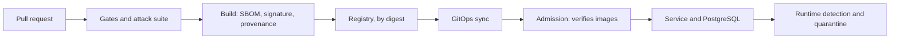

<!-- Author: Nicola Antonello -->

# attack-proven-supply-chain

`attack-proven-supply-chain` is a software supply chain security platform that attacks
itself. Every change is scanned, built, signed and policy-checked on its way to
Kubernetes, and an automated attack suite proves that each control stops a real
attack.

Status: Phase 1 (Foundations) in progress. Nothing runs yet.

## Read more

- [Design](docs/DESIGN.md): goals, invariants, architecture and phases.
- [Decision records](docs/adr/): each decision, with the options it rejected.
- [Further reading](docs/reading/README.md): the sources behind the decisions.

## License

[Apache License 2.0](LICENSE).
