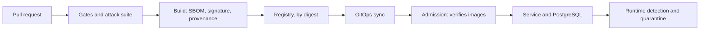

<!-- Author: Nicola Antonello -->

# Design

`attack-proven-supply-chain` is a software supply chain security platform that attacks
itself. Every change is scanned, built, signed and policy-checked on its way to
Kubernetes, and an automated attack suite proves that each control stops a real
attack. This document describes the design as it stands. The decisions behind it,
with the options each one rejected, are in [`docs/adr/`](adr/).

Status: approved by the owner on 2026-11-05. Nothing is built yet.

## Goals

1. Show, with evidence, that each security control works: an attack that succeeds
   without the control is stopped with it, for the reason the control gives.
2. Serve two kinds of reading: a 30-second look at the repository, and a close read
   of the threat model, the attack results and the decisions.
3. Cover what both platform and application security roles look for: the pipeline,
   deployment, the application and runtime.
4. Let anyone with Docker run the whole attack suite with one command.

## Non-goals

- A product. The service is small on purpose, because the platform is the subject.
- High availability, scale or performance. One throwaway cluster is enough.
- Real users, real data or a long-lived deployment. AWS is used for one recorded demo
  and destroyed the same day.
- Breadth for its own sake. A tool that changes no attack result does not belong here.

## Success criteria

1. Within 30 seconds, the README shows what this is, with attack results generated
   from real CI runs.
2. Anyone can clone the repository and run the attack suite with one command.
3. The owner can explain each control: how it works, how it could be bypassed, and
   what it does not cover.
4. Phases 1 to 3 alone make a complete project that can be shown.

## Invariants

These hold everywhere, and the attack suite tests them:

- Every claimed control has an attack that succeeds without it and is stopped with it.
  No attack, no claim.
- A control never blocks the legitimate path, and that is tested too.
- Only images built by this repository's CI, signed and carrying valid provenance, run
  outside the platform's own namespaces ([ADR-0005](adr/0005-which-images-must-be-signed.md)).
- CI holds no long-lived cloud credentials: access is short-lived, through OIDC.
- Security gates fail closed: if a scanner or an admission webhook is down, the artifact
  does not ship.
- Every suppressed finding has a written reason and an expiry date.

## Architecture

A change opens a pull request, where the gates and the attack suite run. Once it
merges, CI builds the images, attaches an SBOM and provenance, signs them and pushes
them to the registry. A GitOps tool syncs the manifests into the cluster, where
admission lets in only images that pass verification. Runtime tools watch the
workloads. The attack suite tries to defeat every stage.

Only the parts named with an ADR below are decided. Each tool for a later stage is a
candidate until its phase starts and an ADR confirms it: SAST with Semgrep or CodeQL,
Trivy, gitleaks and Checkov in the pipeline, Syft and Cosign for SBOMs and signing,
Argo CD and Kyverno for deployment, Falco or Tetragon and Cilium at runtime, and ZAP
for DAST.

### The service

A read-later bookmarks API in Python 3.14 on FastAPI, storing its data in PostgreSQL 18
([ADR-0002](adr/0002-small-service-as-workload.md),
[ADR-0003](adr/0003-python-for-the-service.md),
[ADR-0004](adr/0004-bookmarks-api-on-fastapi-and-postgresql.md),
[ADR-0006](adr/0006-service-api-authentication-and-data-layer.md)).

| Endpoint | What it does |
|---|---|
| `POST /users` | Creates a user and returns their token once |
| `POST /bookmarks` | Saves a link and its title for the caller |
| `GET /bookmarks?q=` | Lists the caller's bookmarks, with an optional search |
| `GET /bookmarks/{id}` | Reads one of the caller's bookmarks |
| `DELETE /bookmarks/{id}` | Deletes one of the caller's bookmarks |
| `GET /healthz` | Tells Kubernetes the service is alive |

- **Authentication.** A random bearer token from `secrets.token_urlsafe(32)`, stored
  only as a SHA-256 digest. Every endpoint needs one except `POST /users` and
  `GET /healthz`.
- **Authorization.** Every query on bookmarks is limited to the caller
  (`WHERE id = %s AND user_id = %s`). Someone else's bookmark returns the same 404 as
  one that does not exist. Bookmark IDs are random UUIDs.
- **Data access.** `psycopg` 3 from its binary wheels, with parameterized SQL and plain
  `def` endpoints, which FastAPI runs in a threadpool.
- **Database.** Two tables, `users` and `bookmarks`. Setup scripts built into the
  PostgreSQL image create the schema and two roles: one that owns the tables, and a
  separate login role for the service with only the table privileges it needs. The
  service's role is neither a superuser nor the owner. The database passwords are
  generated at deployment and passed in as Kubernetes Secrets, never through git.
- **Later.** Fetching page titles arrives in Phase 4, together with its SSRF control
  and attack. Until then, the caller supplies the title.

### Images

There are two images, both built by this repository's CI, and scanned and signed there
from Phase 2: the service, and PostgreSQL rebuilt from a pinned upstream digest
([ADR-0005](adr/0005-which-images-must-be-signed.md)). The signing rule applies to
every namespace except a fixed list of the platform's own, so a namespace nobody thought
about is covered by default. Platform tools are third-party images pinned by digest,
and the threat model records them as an accepted risk.

Every container runs as a non-root user with a read-only root filesystem, no added
capabilities and no privilege escalation. Images are deployed by digest, never by tag.
The one exception is the suite's throwaway cluster, which loads each image under a
tag unique to the run until a registry exists
([ADR-0010](adr/0010-how-tests-reach-the-service.md)).

### The pipeline

- **On every pull request and every push to `main`,** `ci.yml` runs two required jobs,
  `gates` and `attacks`, with no path filters
  ([ADR-0008](adr/0008-repository-ci-and-tooling.md)).
- **On `main`,** a release workflow added in Phase 2 builds and signs the images and
  attaches their SBOMs and provenance.
- **Throughout,** every action is pinned to a full commit SHA, every token is
  read-only unless a job needs one write permission, cloud access goes through OIDC,
  and Python dependencies are locked with `pip-compile --generate-hashes` and installed
  with `--require-hashes --only-binary :all:`.

### The cluster

A throwaway `kind` cluster serves CI and local work. AWS EKS exists only to record the
demo. The workloads run outside the platform's namespaces, where admission enforces the
signing rule from Phase 3. The GitOps tool also arrives in Phase 3, and the runtime
tools in Phase 5.

### The attack suite

The suite is pytest, with one directory per attack in `attacks/`
([ADR-0007](adr/0007-how-the-attack-suite-works.md)). A shared base class requires
four runs from every attack:

| Run | Control | What it tries | Must report |
|---|---|---|---|
| Control off | Off | The attack and its variant | `succeeded` |
| Control on | On | The attack | `blocked` or `detected`, with the expected reason |
| Variant | On | The nearest bypass | `blocked` or `detected`, with the expected reason |
| Legitimate | On | Normal use | It works |

- **Turning a control off.** An application control is removed by
  `attacks/<id>/control-off.patch`, applied to a temporary copy of the code. The suite
  builds a throwaway image from it, loads it only into the test cluster and never pushes
  or signs it. A platform control is simply not installed for that run.
- **One control at a time.** Each run toggles only the control under test. One extra
  normal-use test runs with every control on, to show they do not conflict.
- **Failing safely.** If setup breaks, the run reports `error`, never `blocked`, and the
  suite fails.
- **Isolation.** The suite creates its own `kind` cluster with a unique name and its own
  kubeconfig file, so it cannot touch any other cluster.
- **Traceability.** Each attack names its threat IDs and its control page, and the suite
  fails if either is missing.
- **Results.** The README results table is generated from the suite's output and
  committed. CI regenerates it from its own run and fails on any difference.

The first attack, in Phase 1, is broken object-level authorization. Bob reads Alice's
bookmark by its ID, and the ownership check should stop him with a 404 and
`bookmark_not_found`, after the run first proves that Alice's bookmark exists. The
variant is Bob deleting it, which a check written only for reads would let through.
The legitimate run is Alice reading and deleting her own bookmark.

### The repository and tooling

The repository is `attack-proven-supply-chain`, public, under Apache-2.0
([ADR-0008](adr/0008-repository-ci-and-tooling.md)). A ruleset with no bypass protects
`main`: a pull request with zero approvals, up-to-date required checks, linear history,
no force pushes and no deletions. Merges are rebase only, and merged branches are
deleted automatically. The first commit is the one change that goes straight to `main`,
before the ruleset exists.

`tools/Dockerfile` builds one toolbox image with every command-line tool at a pinned
version and a verified checksum. One wrapper script runs it, on a developer's machine
and in CI alike, so Docker is the only prerequisite.

Every decision is recorded as an ADR as soon as it is accepted
([ADR-0001](adr/0001-record-decisions-as-adrs.md)).

## Threat model

`docs/THREAT_MODEL.md` is written in Phase 1 and grows with every component. Each new
element is checked with STRIDE per element, and anything in the build and delivery
path is also checked against the SLSA threat categories. The component itself is
treated as a target: its API, its default accounts and its own credentials. Every
threat records the attacker's position, what they gain, a priority, its control and
attack, and a status: `open`, `proven`, `accepted` with a reason and an expiry, or
`out of scope`.

## Phases and exit checks

The candidate attacks for Phases 2 to 5 are confirmed with the owner when each phase
starts. The times are rough part-time estimates, none of them measured.

| Phase | What gets built | Candidate attacks | Exit check | Rough time |
|---|---|---|---|---|
| 1. Foundations | The repository, the toolbox, the first threat model, the service and its database image, the harness, `ci.yml` | Broken object-level authorization | The attack proves all four runs in CI, and a pull request that removes the ownership check fails CI. The toolbox works on Windows and in CI. Run time and disk use are measured. | 2 weeks |
| 2. Pipeline controls | Scanners, enforced hash-locked installs, workflow hardening, SBOMs, keyless signing, provenance, a release workflow | Dependency confusion on a local index, a malicious install script, workflow injection, an unpinned action, a committed secret, a known-vulnerable dependency | Each attack is proven. `cosign verify` passes for this CI's identity and fails for any other. A planted injection's result is recorded for each scanner. An expired suppression makes the scan fail again. | 2 weeks |
| 3. Deployment controls | GitOps, admission policy, the pod security baseline, Terraform for EKS, written and scanned but not applied | An unsigned image, one signed by the wrong identity, the upstream `postgres` image, a tag instead of a digest, the webhook down, a new namespace, a privileged pod, insecure Terraform | Each attack is proven, and normal use passes with every control on. Phases 1 to 3 then make a complete project. | 2 weeks |
| 4. Application security depth | Title fetching with its SSRF control, custom SAST rules, the DAST scan, the row-level security decision | SSRF, with a redirect to an internal address as a likely variant, and SQL injection in search | Each attack is proven. DAST covers every endpoint in the OpenAPI definition. Each custom rule flags a planted pattern and stays quiet on clean code. | 1.5 weeks |
| 5. Runtime controls | eBPF detection, default-deny network policy, automated quarantine | A reverse shell to a local listener, and the database reached from the wrong pod | Each attack is proven. The time from detection to quarantine is measured. Normal use triggers no quarantine. | 1.5 weeks |
| 6. Evidence | The time from a critical CVE to a patched deploy, the EKS recording, the 2-minute video, the final README | None | The video is linked. A budget alarm exists before `terraform apply`, and `terraform destroy` is confirmed the same day. | 1 week |

A phase is done when each new control has its four-run proof, its threat model entry
marked `proven` and its control page, and the ADRs and reading list are current. The
order of phases 4 and 5 can be swapped.

## Decisions still open

Each is made when its phase starts, with options and an ADR:

- **Phase 1:** the threat model's first entries.
- **Phase 2:** the SAST tool, the registry, the signing and provenance tooling, base
  images, and the design of each pipeline attack.
- **Phase 3:** the GitOps tool, the admission tool and its policies, how the database
  password reaches the cluster under GitOps, and the design of each deployment attack.
- **Phase 4:** the SSRF control's design, row-level security as a second control, the
  custom SAST rules and the DAST setup.
- **Phase 5:** the detection tool, the network policy engine, and how quarantine works.
- **Phase 6:** the EKS setup and the measurement method for the CVE-to-patched time.

## Risks to check first

| Risk | Checked in | If it fails |
|---|---|---|
| The toolbox cannot reach the `kind` cluster on Windows: the container must also join kind's Docker network | Phase 1 | An install script in WSL, under a new ADR |
| PostgreSQL may not run with a read-only root filesystem: its documentation lists no writable directories | Phase 1 | Find the writable paths and mount them, recorded in the threat model |
| Runners have 14 GB of disk, which may be tight once images pile up | Phase 1 | Prune between runs, or split the attack job |
| Scanners may not see SQL injection through `psycopg` 3: Semgrep's page names only `psycopg2` | Phase 2 | Record the blind spot and cover it with another control |
| Dependabot security updates for `pip-compile` are unconfirmed: GitHub's table gave conflicting readings | Phase 2 | Rely on the scanners to fail CI on a vulnerable dependency |
| Falco and Tetragon need kernel BTF support, unconfirmed on GitHub runners and inside `kind` | Phase 5 | Run those attacks locally only, and say so in the README |
| Keyless signing needs an identity token that forked pull requests do not get (unchecked) | Phase 2 | No effect with one maintainer on branches in the repository itself |

## Decision records

- [ADR-0001: Record decisions as ADRs](adr/0001-record-decisions-as-adrs.md)
- [ADR-0002: A small service in this repository as the workload](adr/0002-small-service-as-workload.md)
- [ADR-0003: Python for the service](adr/0003-python-for-the-service.md)
- [ADR-0004: A bookmarks API on FastAPI and PostgreSQL](adr/0004-bookmarks-api-on-fastapi-and-postgresql.md)
- [ADR-0005: Which images must be signed](adr/0005-which-images-must-be-signed.md)
- [ADR-0006: The service's API, authentication and data layer](adr/0006-service-api-authentication-and-data-layer.md)
- [ADR-0007: How the attack suite works](adr/0007-how-the-attack-suite-works.md)
- [ADR-0008: The repository, CI and tooling](adr/0008-repository-ci-and-tooling.md)
- [ADR-0009: The toolbox's contents and quality gates](adr/0009-toolbox-contents-and-quality-gates.md)
- [ADR-0010: How tests reach the service](adr/0010-how-tests-reach-the-service.md)
