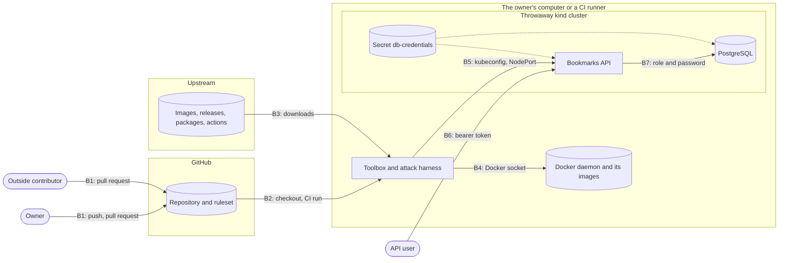

<!-- Author: Nicola Antonello -->

# Threat model

What can go wrong with this project's platform and service, who could make it
happen, and which control stops it. This version covers Phase 1 as designed: the
repository and its ruleset, CI, the toolbox and its downloads, the throwaway `kind`
cluster, and the bookmarks API with its PostgreSQL database. Each later phase adds its
own elements.

A threat is `proven` only when an attack in `attacks/` shows its control stopping it.
Until then it stays `open`, even when the control already exists.

## Method

Each element below is checked with STRIDE per element: spoofing, tampering,
repudiation, information disclosure, denial of service and elevation of privilege.
External actors get S and R; processes get all six; data flows get T, I and D; data
stores get T, I and D, plus R when they hold a log. Every letter either has a threat
row or a reason under [Assumptions](#assumptions). The components themselves are
treated as targets too, and the build path is also walked against the SLSA threats.
Tool and platform behavior was checked against its documentation, or measured, on
2026-11-06. Anything that was not is marked unverified.

Priority follows one rule. High: an attacker with little access reaches production
code or credentials. Low: the attacker already needs cluster admin. Medium: everything
else.

## Data flow

## Assets

| ID | Asset | Why it matters |
| --- | --- | --- |
| A1 | The code and history on `main` | Everything built and deployed comes from it. |
| A2 | The ruleset and required checks on `main` | They decide what can reach A1. |
| A3 | The toolbox image and the pinned inputs it is built from | Every gate and attack runs inside it. |
| A4 | The machines that run the toolbox: the owner's computer and CI runners | The toolbox controls their Docker daemons. |
| A5 | The attack results: the README table and the runs behind it | They are the project's evidence. A false `blocked` is a false claim. |
| A6 | Users' bookmarks | The service's data. A saved URL can carry a credential, such as a signed link. |
| A7 | Users' tokens, and their digests in the database | A token is the only proof of who a user is. |
| A8 | The two database passwords: PostgreSQL's superuser and the service's role | They decide who can reach the data directly. |
| A9 | The test cluster and its kubeconfig | The kubeconfig is cluster admin. |
| A10 | The owner's GitHub account and tokens | An administrator can change the ruleset itself. |

## Trust boundaries

| ID | Boundary | What crosses it |
| --- | --- | --- |
| B1 | Contributors to the repository | Pushes and pull requests, from the owner and from anyone with a fork. |
| B2 | The repository to CI | A pull request's code, run on a GitHub-hosted runner. |
| B3 | Upstream to the build | Base images, release files, Python packages and actions. |
| B4 | The toolbox to the Docker daemon | The socket, which gives whatever runs in the toolbox control of the host's Docker. |
| B5 | The toolbox to the test cluster | A cluster-admin kubeconfig, and HTTP to the service's NodePort. |
| B6 | API clients to the API | Each request carries one user's token, and may name another user's data. |
| B7 | The API to PostgreSQL | The service's database role and its password. |

## STRIDE coverage

Each element, its type, and where each STRIDE letter is handled: a threat ID, or an
assumption number.

| Element | Type | Coverage |
| --- | --- | --- |
| Owner | External actor | S: T-REPO-3, T-REPO-5. R: T-REPO-5 |
| Outside contributor | External actor | S: T-REPO-5. R: AS4 |
| API user | External actor | S: T-API-4, AS3. R: AS5 |
| Upstream projects and registries | External actor | S: T-DEPS-1. R: AS6 |
| Toolbox and attack harness | Process | S: AS7. T: T-DEPS-1, T-SUITE-1, T-SUITE-2. R: AS8. I: T-TOOLBOX-1. D: AS9. E: T-TOOLBOX-1, T-DEPS-4 |
| CI job on a runner | Process | S: T-CI-5. T: T-CI-1, T-CI-2, AS17. R: AS8. I: T-CI-3. D: AS9. E: T-CI-3, T-CI-4, T-CI-6 |
| Bookmarks API | Process | S: T-API-4. T: T-API-1, T-API-3, T-API-7. R: AS5. I: T-API-1, T-API-2, T-API-6, T-API-9. D: T-API-5. E: T-API-3, T-CLUSTER-3, T-DEPS-5 |
| PostgreSQL | Process | S: T-DB-3, T-DB-5, AS2. T: T-DB-1. R: AS5. I: T-DB-2. D: T-API-5. E: T-DB-1, T-DEPS-5 |
| Test cluster | Process | S: T-CLUSTER-1. T: T-CLUSTER-2. R: AS8. I: T-DB-4. D: AS9. E: T-CLUSTER-3, T-CLUSTER-4 |
| Repository, whose history is its log | Data store | T: T-REPO-1, T-REPO-2. R: T-REPO-5. I: T-REPO-4. D: T-REPO-1 |
| Database | Data store | T: T-API-1, T-DB-1. I: T-API-1, T-DB-2. D: T-API-1, T-API-5 |
| Secret `db-credentials` | Data store | T: AS10. I: T-DB-4. D: AS10 |
| Images on the Docker daemon | Data store | T: T-CLUSTER-2, T-TOOLBOX-1. I: AS11. D: AS9 |
| README results table | Data store | T: T-SUITE-3. I: AS12. D: AS12 |
| Pushes and pull requests | Data flow, B1 | T: T-REPO-2. I: AS13. D: AS13 |
| Checkout into CI | Data flow, B2 | T: T-CI-1, T-CI-6. I: T-CI-3. D: AS9 |
| Downloads | Data flow, B3 | T: T-DEPS-1, T-DEPS-2, T-DEPS-3. I: AS13. D: AS14 |
| Docker socket | Data flow, B4 | T: T-TOOLBOX-1. I: T-TOOLBOX-1. D: AS9 |
| Harness to the cluster | Data flow, B5 | T: T-CLUSTER-1. I: AS15. D: AS9 |
| Client to the API | Data flow, B6 | T: T-API-8. I: T-API-8. D: T-API-5 |
| API to PostgreSQL | Data flow, B7 | T: AS16. I: AS16. D: T-API-5 |

## SLSA threats on the build path

| SLSA threat | In Phase 1 | Where |
| --- | --- | --- |
| Producer | The owner is the only maintainer | T-REPO-3 |
| Modifying the source | Pull requests into `main` | T-REPO-1, T-REPO-2, T-REPO-5 |
| Source code management | GitHub hosts the repository | AS1 |
| External build parameters | Workflow events and their fields | T-CI-1, T-CI-4 |
| Build process | The CI runner and the toolbox | T-CI-3, T-CI-6, T-TOOLBOX-1 |
| Artifact publication | Nothing is published. Images are loaded only into throwaway clusters | T-CLUSTER-2. Publishing starts in Phase 2 |
| Distribution channel | None yet | Phase 2 adds a registry |
| Package selection and usage | Nothing consumes this project's images yet | Phase 3 adds admission by digest and signature |
| Dependencies | Base images, tool releases, Python packages and actions | T-DEPS-1 to T-DEPS-5, T-CI-2 |
| Availability | Upstream sources can be down | AS14 |
| Verification | Nothing verifies an artifact before it runs yet | Phases 2 and 3 |

## Threats

### Repository

| ID | Attacker position | Action and impact | STRIDE | Boundary | Priority | Control | Attack | Status |
| --- | --- | --- | --- | --- | --- | --- | --- | --- |
| T-REPO-1 | Write access to the repository: the owner by mistake, or anyone with the owner's token | Pushes straight to `main`, force-pushes over its history or deletes it, skipping pull requests and checks | T, D | B1 | Medium | Ruleset `protect-main` with no bypass: pull request required, linear history, no force push, no deletion (ADR-0008) | none yet | open |
| T-REPO-2 | Opened a pull request from a fork | Gets malicious code merged into `main`, where every later build uses it | T | B1 | High | The owner reviews every pull request, and the required checks run on it. With zero required approvals, nobody else reviews (ADR-0008) | none yet | accepted: one maintainer, so review is the only human check (ADR-0008). Review by 2027-05-01. Owner: Nicola Antonello |
| T-REPO-3 | Stole the owner's GitHub token or session | Edits or deletes the ruleset as an administrator, then pushes anything to `main` | S, E | B1 | Medium | GitHub account security, outside this repository. No rule can stop the administrator who owns it | none yet | accepted: account security sits outside the repository. Review by 2027-05-01. Owner: Nicola Antonello |
| T-REPO-4 | Reads the public repository | Finds a token or password committed by mistake, and uses it until it is rotated | I | B1 | High | gitleaks on the full history and on staged changes in `gates`. GitHub secret scanning with push protection, which is on for this repository | none yet (Phase 2 candidate: a committed secret) | open |
| T-REPO-5 | Can create commits: anyone with a fork, or a stolen token | Writes commits under the owner's name and email, so the history misattributes the change | S, R | B1 | Medium | none: commits are not signed, and the ruleset does not require signatures | none yet | open |

### CI

| ID | Attacker position | Action and impact | STRIDE | Boundary | Priority | Control | Attack | Status |
| --- | --- | --- | --- | --- | --- | --- | --- | --- |
| T-CI-1 | Opened a pull request | Puts shell syntax in a title, branch name or other event field that a workflow pastes into `run:`, and runs it in CI | T, E | B2 | Medium | No `${{ github.event.* }}` inside `run:`, and zizmor's template-injection audit in `gates` | none yet (Phase 2 candidate: workflow injection) | open |
| T-CI-2 | Controls an action's repository, or moves one of its tags | Changes the code behind a tag a workflow uses, which then runs in CI | T | B3 | Medium | Every action pinned to a full commit SHA, and zizmor's audit for unpinned actions | none yet (Phase 2 candidate: an unpinned action) | open |
| T-CI-3 | Code execution in a CI step | Reads the token that `actions/checkout` would store in `.git/config`, or leaks it in an artifact | I, E | B2 | Medium | `persist-credentials: false`, `permissions: contents: read`, a read-only default token for the repository, and zizmor's audit for persisted credentials | none yet | open |
| T-CI-4 | Opened a pull request | Gets a `pull_request_target` workflow to check out and run the pull request's code with a write token and secrets | E | B2 | High | No `pull_request_target`. On `pull_request`, a fork's token is read-only and secrets are not passed. zizmor's audit for dangerous triggers | none yet | open |
| T-CI-5 | Holds a token or app that can post commit statuses | Posts a passing `gates` or `attacks` status, so a pull request merges without the real checks | S, T | B1 | Medium | Required checks tied to the GitHub Actions app, `integration_id` 15368 (ADR-0009) | none yet | open |
| T-CI-6 | Opened a pull request. A first-time contributor's workflows wait for the owner's approval | Runs any code on a GitHub-hosted runner through the pull request's own scripts and tests, including the toolbox's Docker socket there | E | B2 | Medium | Each GitHub-hosted runner is a new virtual machine. The token is read-only and no secrets are passed | none yet | accepted: running a pull request's code is what CI is for, and the runner holds nothing to steal. Review by 2027-05-01. Owner: Nicola Antonello |

### Toolbox

| ID | Attacker position | Action and impact | STRIDE | Boundary | Priority | Control | Attack | Status |
| --- | --- | --- | --- | --- | --- | --- | --- | --- |
| T-TOOLBOX-1 | Code execution inside the toolbox on the owner's computer: a malicious tool, package or test, or a contributor's pull request run locally | Uses the mounted Docker socket to start a privileged container or mount the host's files, which amounts to root on the machine and reaches the owner's credentials | T, I, E | B4 | High | none inside the toolbox: kind needs the socket (ADR-0008) | none yet | accepted: running the toolbox means trusting this repository's code (ADR-0008). Review by 2027-05-01. Owner: Nicola Antonello |

### Downloads

| ID | Attacker position | Action and impact | STRIDE | Boundary | Priority | Control | Attack | Status |
| --- | --- | --- | --- | --- | --- | --- | --- | --- |
| T-DEPS-1 | Controls a download location or the path to it: moves an image tag, replaces a release file, or sits in the middle | Swaps a base image, tool or package for different bytes, which then run with the Docker socket | T | B3 | Medium | Every input pinned: images by digest, release files by the SHA-256 their project publishes, Python packages by hash. Any difference fails the build (ADR-0008, ADR-0009) | none yet | open |
| T-DEPS-2 | Compromised an upstream project before its release was pinned here | Ships a malicious release that this repository then pins, so the checksum vouches for the attacker's bytes | T | B3 | Medium | none in Phase 1: a pin fixes the bytes, not their intent (ADR-0009) | none yet | accepted: no Phase 1 control can judge an upstream release. Review when Phase 2 starts, by 2027-01-31. Owner: Nicola Antonello |
| T-DEPS-3 | Published a package on a public index under a name this project installs | Gets pip to install their package instead of the intended one | T, E | B3 | Medium | Hash-locked requirements, installed with `--require-hashes` (ADR-0008) | none yet (Phase 2 candidate: dependency confusion on a local index) | open |
| T-DEPS-4 | Published a package whose build runs their code | Runs code at install time from a source distribution | E | B3 | Medium | `--only-binary :all:`, so no source distribution is ever built (ADR-0003, ADR-0008) | none yet (Phase 2 candidate: a malicious install script) | open |
| T-DEPS-5 | Knows a vulnerability in a pinned package or base image | Exploits it in the toolbox, the service or PostgreSQL | T, I, E | B3 | Medium | none in Phase 1: versions move by hand (ADR-0009) | none yet (Phase 2 candidate: a known-vulnerable dependency) | accepted: scanning is Phase 2's. Review when Phase 2 starts, by 2027-01-31. Owner: Nicola Antonello |

### Attack suite

| ID | Attacker position | Action and impact | STRIDE | Boundary | Priority | Control | Attack | Status |
| --- | --- | --- | --- | --- | --- | --- | --- | --- |
| T-SUITE-1 | Can change code in a pull request, or the owner by mistake | Breaks an attack's setup so that it fails, and the failure counts as the control stopping it: a false `blocked` | T | B1 | Medium | A stopped run must show its expected reason. Anything else reports `error`, never `blocked`, and fails the suite (ADR-0007) | none yet | open |
| T-SUITE-2 | Can change code in a pull request, or the owner by mistake | Changes the code so that a control-off patch no longer removes the control, and the control-off run stops proving anything | T | B1 | Medium | `git apply` refuses a patch that does not apply, the suite applies every patch to the current code, and the control-off run must succeed (ADR-0007) | none yet | open |
| T-SUITE-3 | Can change the README | Edits the results table to show results no run produced | T, R | B1 | Medium | CI regenerates the table from its own run and fails on any difference (ADR-0007) | none yet | open |

### Test cluster

| ID | Attacker position | Action and impact | STRIDE | Boundary | Priority | Control | Attack | Status |
| --- | --- | --- | --- | --- | --- | --- | --- | --- |
| T-CLUSTER-1 | Runs the suite on a machine whose default kubeconfig points at a real cluster | The suite changes or deletes resources in that cluster instead of its own | T, D | B5 | Medium | The suite creates its own uniquely named cluster and its own kubeconfig file, and uses only that file (ADR-0007) | none yet | open |
| T-CLUSTER-2 | Can run the suite or reach its images | A control-off image, built without its control, reaches a cluster or registry outside the test | T | B5 | Medium | Control-off images get a tag unique to the run, are loaded only into the suite's cluster, are never pushed or signed, and are removed afterwards (ADR-0007) | none yet | open |
| T-CLUSTER-3 | Code execution in the API's pod | Calls the Kubernetes API with the pod's service account token, to read Secrets or change workloads | I, E | B5 | Medium | `automountServiceAccountToken: false`. The container runs as a non-root user with a read-only root filesystem, no capabilities, no privilege escalation and the runtime's default seccomp profile | none yet (Phase 3 candidate: a privileged pod) | open |
| T-CLUSTER-4 | Code execution in any pod in the cluster | Connects to PostgreSQL directly, since no network policy limits who reaches it, and tries the database's roles | S, I, E | B7 | Medium | Passwords generated for each deployment. No network policy until Phase 5 | none yet (Phase 5 candidate: the database reached from the wrong pod) | open |

### API

| ID | Attacker position | Action and impact | STRIDE | Boundary | Priority | Control | Attack | Status |
| --- | --- | --- | --- | --- | --- | --- | --- | --- |
| T-API-1 | Has their own account and token | Reads or deletes another user's bookmark by its ID | I, T | B6 | High | Ownership check: every query on a bookmark is limited to the caller, `WHERE id = %s AND user_id = %s` (ADR-0006) | none yet | open |
| T-API-2 | Has their own account and token | Lists or searches another user's bookmarks | I | B6 | High | The same `user_id` filter on listing, tested by unit tests only and not claimed (ADR-0010) | none yet | open |
| T-API-3 | Has their own account and token | Puts SQL syntax in the search text to read or change data beyond their own | T, I, E | B6 | High | Parameterized queries with psycopg 3, a search pattern that escapes `%`, `_` and `\`, and a database role with only the table privileges it needs (ADR-0006) | none yet (Phase 4 candidate: SQL injection in search) | open |
| T-API-4 | Obtained another user's token: from a log, a shared screen or a compromised client | Acts as that user. The token never expires and cannot be revoked | S | B6 | Medium | none: a lost token is replaced by creating a new user (ADR-0006) | none yet | accepted: sessions and revocation are outside the service's scope. Review by 2027-05-01. Owner: Nicola Antonello |
| T-API-5 | Can reach the API | Creates users and bookmarks without limit, or sends very large requests, until the service or its database runs out of resources | D | B6 | Medium | none: no rate, size or resource limits in Phase 1 (ADR-0006) | none yet | accepted: no attack in scope needs them. Review before the EKS demo, by 2027-03-31. Owner: Nicola Antonello |
| T-API-6 | Has their own account and token | Compares responses to learn which bookmark IDs exist | I | B6 | Medium | Random UUIDs, and someone else's bookmark gets the same 404, byte for byte, as one that does not exist (ADR-0006) | none yet | open |
| T-API-7 | Has their own account and token | Saves a `javascript:` or other non-web URL that a client later renders as a link | T | B6 | Medium | Only absolute `http` and `https` URLs of up to 2048 characters are accepted | none yet | open |
| T-API-8 | Can read traffic between a client and the API | Reads tokens and bookmarks in transit, since the API speaks plain HTTP | T, I | B6 | Medium | none: no TLS in Phase 1 | none yet | accepted: the API runs only in throwaway local clusters until the demo. Review before the EKS demo, by 2027-03-31. Owner: Nicola Antonello |
| T-API-9 | Has their own account and token | Makes the service fetch an internal address | I, E | B6 | Medium | Not applicable yet: the service fetches nothing | none yet | out of scope: title fetching arrives in Phase 4 with its SSRF control (ADR-0006) |

### Database

| ID | Attacker position | Action and impact | STRIDE | Boundary | Priority | Control | Attack | Status |
| --- | --- | --- | --- | --- | --- | --- | --- | --- |
| T-DB-1 | Code execution in the service, or SQL injection through it | Uses the service's database role to run commands on the server with `COPY ... PROGRAM`, or to change the schema | T, E | B7 | Medium | A separate login role that is neither superuser nor table owner, with only the table privileges it needs (ADR-0006) | none yet (Phase 4 candidate: SQL injection in search) | open |
| T-DB-2 | Can read the database or a dump of it | Takes users' tokens and acts as them | S, I | B7 | Medium | Only each token's SHA-256 digest is stored. A token is 32 random bytes, so its digest cannot be reversed (ADR-0006) | none yet | open |
| T-DB-3 | Can read the repository, CI logs or the process list | Finds a database password in git, a log or a command line | S, I | B5 | High | Passwords generated for each deployment and passed through stdin, never as an argument or in git. gitleaks in `gates` | none yet | open |
| T-DB-4 | Can read Secrets or create pods in the namespace, which in practice is cluster admin | Reads both passwords from the `db-credentials` Secret, which Kubernetes stores unencrypted by default | I | B5 | Low | Passwords generated for each deployment, in a cluster deleted after the run | none yet | accepted: the cluster is throwaway. Review when Phase 3 decides how the password reaches the cluster, by 2027-02-28. Owner: Nicola Antonello |
| T-DB-5 | Code execution in any pod, after a deployment that left the service's password unset | Connects as the service's role with no password, or a default one | S | B7 | Medium | Setup reads the password with psql's `\getenv`. If it is unset, `:'api_password'` stays as written, the statement fails, and setup stops under `ON_ERROR_STOP=1` (ADR-0010) | none yet | open |

## Assumptions

- **AS1.** GitHub, Docker Hub, PyPI and the projects whose releases are pinned serve
  what they published at the time of pinning. GitHub itself, as the source code
  manager, is trusted. T-DEPS-2 covers a release that was malicious when pinned.
- **AS2.** The PostgreSQL image's `initdb` trusts connections from inside its own
  container (ADR-0010), so anything running there connects as the superuser with no
  password. That adds no reach, since anything running there already has the data.
  The risk is a test that connects from inside the container and passes without a
  password, so every database test connects from another container.
- **AS3.** Guessing a token is not a threat: it is 32 random bytes from
  `secrets.token_urlsafe(32)`.
- **AS4.** R for the owner and outside contributors: GitHub records who opened,
  reviewed and merged each pull request. Commit authorship is the gap, T-REPO-5.
- **AS5.** R for API users, the API and PostgreSQL: neither keeps an audit log, and no
  threat in scope depends on proving who did what.
- **AS6.** R for upstream projects: their release history is theirs, and this
  repository's pins record what it used.
- **AS7.** S for the toolbox: replacing or retagging its image needs control of the
  Docker daemon, which is already root on the host (T-TOOLBOX-1).
- **AS8.** R for the toolbox, CI jobs and the test cluster: GitHub keeps CI logs, local
  runs keep none, and nothing in scope depends on them.
- **AS9.** D for the toolbox, CI jobs, the test cluster and their flows: a run that
  hangs or runs out of disk fails. CI's timeouts end it, and a failed required check
  blocks the merge, so these failures fail closed.
- **AS10.** T and D for the Secret: changing or deleting it needs cluster admin, which
  already controls everything in the throwaway cluster, and a broken Secret fails the
  deployment.
- **AS11.** I for images: images hold no secrets. Passwords arrive at run time.
- **AS12.** I and D for the results table: it is public by design, and a lost or
  changed table fails CI's comparison (T-SUITE-3).
- **AS13.** T, I and D for pushes and downloads in transit: they use HTTPS with the
  server's certificate, and their contents are public anyway, except the owner's
  credentials (T-REPO-3).
- **AS14.** D for downloads: if a source is down, the build fails. There is no
  fallback source.
- **AS15.** I between the harness and the cluster: the harness talks to the API
  server over TLS with the cluster's own certificate authority. Measured on
  2026-11-06: kind publishes only the API server's port, on the host's loopback
  address, so a NodePort is reachable only from kind's Docker network.
- **AS16.** T and I between the API and PostgreSQL: the traffic is not encrypted, but
  reading it needs a position inside the cluster that already reaches the database
  (T-CLUSTER-4).
- **AS17.** Each GitHub-hosted runner is a new virtual machine, and Phase 1 keeps no
  caches or artifacts between runs, so nothing one run leaves behind reaches the next.
- **AS18.** Phase 1 runs no platform tools in the cluster: admission, GitOps and
  runtime tools arrive in later phases, each with its own threats.

## Open questions

1. T-API-1, T-API-2 and T-API-3 are High because a saved URL can carry a credential,
   such as a signed link. Without that, the priority rule would make them Medium.
   Should every user's data count as High in its own right?
2. Should outside contributions be run only in CI, never with the local toolbox
   (T-TOOLBOX-1)? If so, the README's quickstart should say so.
3. Should `main` require signed commits (T-REPO-5)? Unverified: this may not work
   together with rebase-only merges.
4. Should the repository also require actions pinned to a full commit SHA, a GitHub
   setting that is off today, as a second control behind zizmor's audit (T-CI-2)?
5. Does the owner's GitHub account use two-factor authentication (T-REPO-3)?
   Unverified: the CLI's token cannot read that setting.
6. The accepted rows are accepted in the owner's name. Merging this file confirms
   them.
